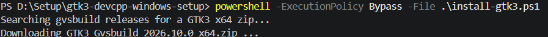
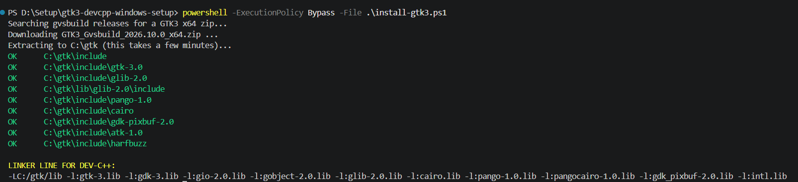
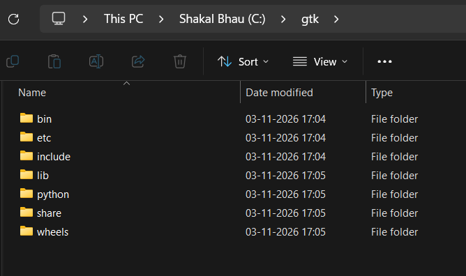
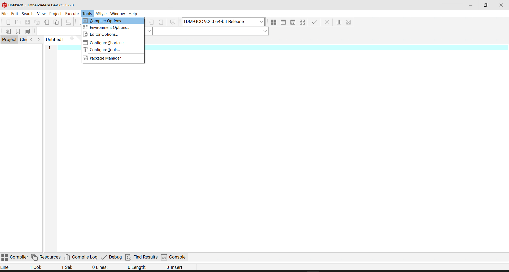
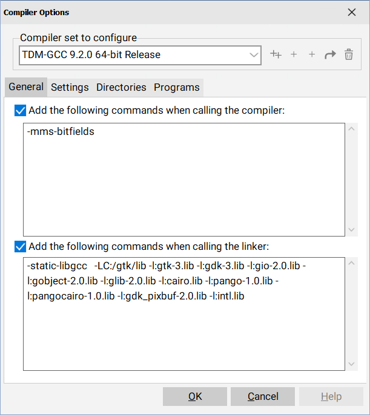
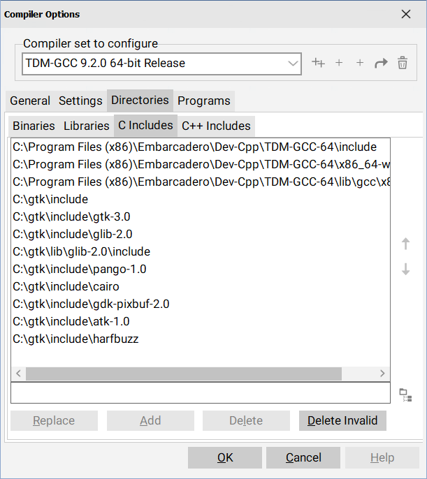
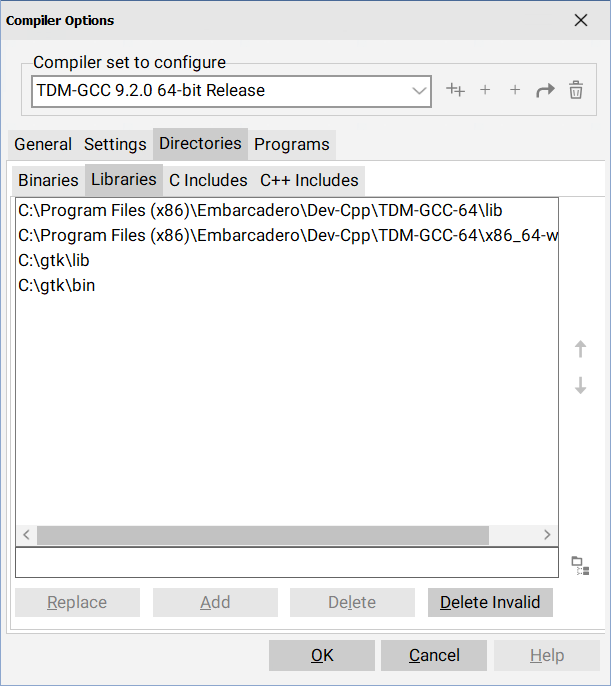
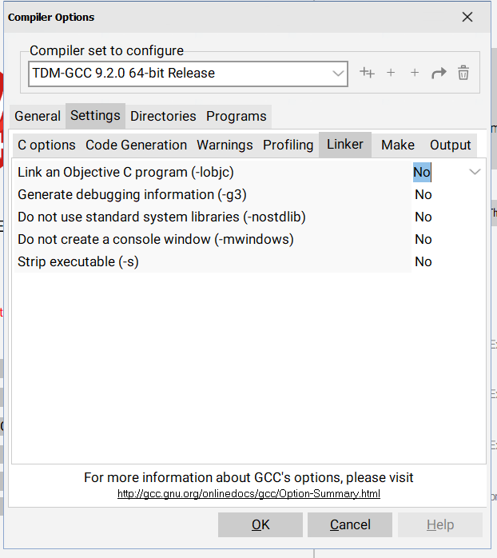
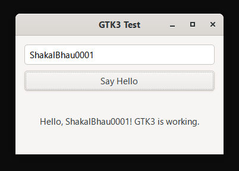

# 🪟 GTK3-DevCpp-Windows-Setup 🖼️

A step-by-step **GTK3 setup guide for Dev-C++ on Windows 11** that lets you build **GTK3 GUI apps in C** — **without MSYS2** — using a one-command **PowerShell installer** and a ready-made **test program**.

This project is built for **students**, **C beginners who want GUI programming**, and anyone who wants a **simple GTK3 + Dev-C++ environment** without a heavy toolchain, combining an **automatic installer script**, a **screenshot-based setup guide** and a **hello-world GTK3 example**.

---

## 🧱 Project Structure

```bash
gtk3-devcpp-windows-setup/
│
├── assets/              # Screenshots
├── examples/
│   └── hello_gtk.c      # GTK3 test program
├── install-gtk3.ps1     # PowerShell installer
├── LICENSE              # Project license
└── README.md            # Project documentation
```

---

## ✨ Features

### ⚙️ Automatic GTK3 Installer

- Searches the latest **50 releases** of **gvsbuild** for a `GTK3_Gvsbuild_*_x64.zip` build
- **Downloads** the GTK3 x64 zip automatically
- **Extracts** it to `C:\gtk`
- Fixes the folder layout if the zip has one extra top folder
- Adds `C:\gtk\bin` to your **user PATH** (only if it is not already there)

### ✅ Built-in Verification

- Checks that every required **include folder** exists (`gtk-3.0`, `glib-2.0`, `pango-1.0`, `cairo`, `gdk-pixbuf-2.0`, `atk-1.0`, `harfbuzz`)
- Prints 🟢 **OK** or 🔴 **MISSING** for each folder
- Detects the **real `.lib` file names** on your system (`gtk-3.lib` / `gtk-3.0.lib`, etc.)
- Prints a ready-to-paste **linker line for Dev-C++**

### 🧪 Test Program (`hello_gtk.c`)

- Small GTK3 window with a **text entry**, a **button** and a **label**
- Type your name → click **Say Hello** → label shows `Hello, <name>! GTK3 is working.`
- Shows `Please enter your name` if the entry is empty
- Quick way to confirm the whole setup works

### 🚫 No MSYS2 Needed

- Uses a **pre-built GTK3 package** — no package manager or terminal toolchain to install
- Works with the normal **Embarcadero Dev-C++ 6.3** and **TDM-GCC 9.2.0 64-bit**

---

## 🛠 Technologies Used

| Technology                  | Purpose                                 |
| --------------------------- | --------------------------------------- |
| **C**                       | GTK3 test program                       |
| **GTK3 (gvsbuild)**         | Pre-built GTK3 libraries for Windows    |
| **PowerShell**              | Installer script                        |
| **GitHub Releases API**     | Finding the latest GTK3 x64 build       |
| **Embarcadero Dev-C++ 6.3** | IDE used to write and compile GTK3 code |
| **TDM-GCC 9.2.0 (64-bit)**  | C compiler used by Dev-C++              |

---

## ▶️ How to Run

### 1️⃣ Clone the repository

```bash
git clone https://github.com/ShakalBhau0001/gtk3-devcpp-windows-setup.git
```

### 2️⃣ Enter the project directory

```bash
cd gtk3-devcpp-windows-setup
```

### 3️⃣ Run the GTK3 Installer

```powershell
powershell -ExecutionPolicy Bypass -File .\install-gtk3.ps1
```

> ℹ️ Extraction takes a few minutes. When it finishes, **copy the LINKER LINE** shown at the end — you need it in the next step.

### 4️⃣ Configure Dev-C++

Open **Dev-C++** → **Tools** → **Compiler Options**, and select **TDM-GCC 9.2.0 64-bit Release**.

**General tab**

- Tick **Add the following commands when calling the compiler** and add:

```bash
-mms-bitfields
```

- Tick **Add the following commands when calling the linker** and paste the linker line from the installer (with `-static-libgcc` in front):

```bash
-static-libgcc -LC:/gtk/lib -l:gtk-3.lib -l:gdk-3.lib -l:gio-2.0.lib -l:gobject-2.0.lib -l:glib-2.0.lib -l:cairo.lib -l:pango-1.0.lib -l:pangocairo-1.0.lib -l:gdk_pixbuf-2.0.lib -l:intl.lib
```

**Directories tab → C Includes** — add:

```bash
C:\gtk\include
C:\gtk\include\gtk-3.0
C:\gtk\include\glib-2.0
C:\gtk\lib\glib-2.0\include
C:\gtk\include\pango-1.0
C:\gtk\include\cairo
C:\gtk\include\gdk-pixbuf-2.0
C:\gtk\include\atk-1.0
C:\gtk\include\harfbuzz
```

**Directories tab → Libraries** — add:

```bash
C:\gtk\lib
C:\gtk\bin
```

> ℹ️ Restart Dev-C++ after the installer so the new PATH is picked up.

### 5️⃣ Test the Setup

- Open `examples/hello_gtk.c` in Dev-C++
- Press **F11** (Compile & Run)
- A **GTK3 Test** window should open

---

## ▶️ Usage

### Installer (`install-gtk3.ps1`)

```bash
PS D:\Setup\gtk3-devcpp-windows-setup> powershell -ExecutionPolicy Bypass -File .\install-gtk3.ps1
Searching gvsbuild releases for a GTK3 x64 zip...
Downloading GTK3_Gvsbuild_2026.10.0_x64.zip ...
Extracting to C:\gtk (this takes a few minutes)...
OK      C:\gtk\include
OK      C:\gtk\include\gtk-3.0
OK      C:\gtk\include\glib-2.0
OK      C:\gtk\lib\glib-2.0\include
OK      C:\gtk\include\pango-1.0
OK      C:\gtk\include\cairo
OK      C:\gtk\include\gdk-pixbuf-2.0
OK      C:\gtk\include\atk-1.0
OK      C:\gtk\include\harfbuzz

LINKER LINE FOR DEV-C++:
-LC:/gtk/lib -l:gtk-3.lib -l:gdk-3.lib -l:gio-2.0.lib -l:gobject-2.0.lib -l:glib-2.0.lib -l:cairo.lib -l:pango-1.0.lib -l:pangocairo-1.0.lib -l:gdk_pixbuf-2.0.lib -l:intl.lib
```

### Test Program (`hello_gtk.c`)

```bash
Window title : GTK3 Test
Entry        : Enter your name
Button       : Say Hello
Label        : Waiting for input...

Input  : ShakalBhau0001
Result : Hello, ShakalBhau0001! GTK3 is working.
```

---

## 📁 Requirements

- **Operating System:** Windows 11 (64-bit)
- **IDE:** Embarcadero Dev-C++ 6.3
- **Compiler:** TDM-GCC 9.2.0 64-bit Release
- **PowerShell:** Used to run the installer (`-ExecutionPolicy Bypass`)
- **Internet Connection:** Required (GitHub API + GTK3 zip download)
- **Disk Location:** GTK3 is installed to `C:\gtk`

> ⚠️ The installer adds `C:\gtk\bin` to your **user PATH**. Restart Dev-C++ after the installation.

---

## ⚙️ How It Works

**1️⃣ Finding GTK3**

- Calls the GitHub Releases API of **wingtk/gvsbuild** (latest 50 releases)
- Picks the first asset matching `GTK3_Gvsbuild_*_x64.zip`

**2️⃣ Download & Extract**

- Downloads the zip to your `TEMP` folder
- Extracts it to `C:\gtk` and moves files up if the zip had one extra top folder

**3️⃣ PATH Setup**

- Adds `C:\gtk\bin` to the **user PATH** so Windows can find the GTK DLLs at runtime

**4️⃣ Verification**

- Checks that all required include folders exist and prints **OK / MISSING**

**5️⃣ Linker Line**

- Looks for the real `.lib` names inside `C:\gtk\lib`
- Builds the `-l:` linker flags automatically so you can paste them into Dev-C++

---

## ⚠️ Common Errors

- **Script is blocked** → Run it with `powershell -ExecutionPolicy Bypass -File .\install-gtk3.ps1`
- **No GTK3 zip found in the latest 50 releases** → Open `https://github.com/wingtk/gvsbuild/releases` and look at older releases
- **MISSING folder in the check list** → Extraction was incomplete — delete `C:\gtk` and run the installer again
- **GTK DLLs not found when running the program** → Make sure `C:\gtk\bin` is in PATH and restart Dev-C++
- **Linking errors** → Re-check that the linker line was pasted correctly in **Compiler Options → General**
- **No internet connection** → The GitHub API request or the download fails

---

## 🌟 Future Enhancements

- Support for **Windows 10**
- Optional **uninstall script** (remove `C:\gtk` and the PATH entry)
- Add **more GTK3 examples** (grid layout, menus, dialogs, file chooser)
- Add a **Makefile / command-line compile** guide
- Add a **troubleshooting** section with common compiler messages
- Auto-configure **Dev-C++ settings** from the script

---

## 📦 Related Projects

This repository focuses on a **simple GTK3 + Dev-C++ setup for Windows**
implemented as a **step-by-step guide with an installer script**.

The goal of this project is to:

- Set up GTK3 on Windows **without MSYS2**
- Practice **GUI programming in C** with GTK3
- Learn how compiler, include and library settings work in Dev-C++

For more advanced, security-focused CLI tools, check out:

> 🔗 **[CLI Projects](https://github.com/stars/ShakalBhau0001/lists/cli-projects)**

---

## ⚠️ Disclaimer

> This project is intended for **educational and learning purposes only**.

> _The installer downloads a third-party GTK3 build from the gvsbuild GitHub releases. Check the downloaded files if you want to be extra safe, and note that this setup was tested with Windows 11, Dev-C++ 6.3 and TDM-GCC 9.2.0 64-bit._

---

## 📸 Preview

### 1. **Run the Installer**



### 2. **Installer Output & Linker Line**



### 3. **GTK3 Folder (C:\gtk)**



### 4. **Tools → Compiler Options**



### 5. **General Tab (Compiler & Linker Commands)**



### 6. **Directories → C Includes**



### 7. **Directories → Libraries**



### 8. **Settings → Linker**



### 9. **Test Program Output**



---

## 🪪 Author

> **Creator: Shakal Bhau**

> **GitHub: [ShakalBhau0001](https://github.com/ShakalBhau0001)**

---

## ⭐ Support

If you like this project, consider giving it a ⭐ on GitHub!

---
